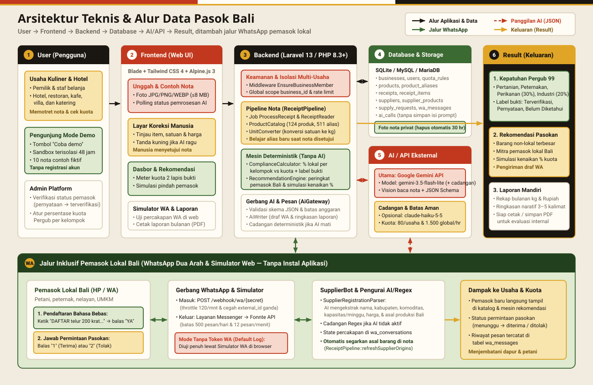

# Proposal Karya — Bali DigiFest 2026 (AI Web Innovation Challenge)

## Cover

| Atribut | Keterangan |
|---|---|
| **Nama Produk / Aplikasi** | **Pasok Bali** |
| **Deskripsi Singkat** | Aplikasi web berbasis AI pembaca nota belanja untuk mengukur mandiri kepatuhan Pergub Bali No. 99/2018 dan menghubungkan usaha kuliner/hotel dengan pemasok lokal lewat WhatsApp |
| **Kompetisi & Kategori** | Bali DigiFest 2026 — AI Web Innovation Challenge |
| **Nama Tim** | `[ISI ARI]` |
| **Ketua & Anggota Tim** | `[ISI ARI]` |
| **Instansi / Domisili** | `[ISI ARI]` |
| **Kontak (Email / Telepon)** | `[ISI ARI]` |
| **Tanggal Penyusunan** | November 2026 |

---

## 1. Problem & Background

Pemerintah Provinsi Bali menerbitkan **Peraturan Gubernur Bali Nomor 99 Tahun 2018** tentang Pemasaran dan Pemanfaatan Produk Pertanian, Perikanan dan Industri Lokal Bali. Regulasi yang berlaku sejak 2019 ini meminta usaha akomodasi dan kuliner menyerap produk lokal Bali dengan kuota volume minimal per kelompok: **30% volume** untuk pertanian (tanaman pangan, hortikultura, perkebunan), **30% volume** untuk peternakan, **30% volume** untuk perikanan, dan **20% volume** untuk industri lokal Bali (angka bawaan di tabel `quota_rules` yang dapat diubah admin dan perlu dicocokkan dengan naskah resmi JDIH Provinsi Bali sebelum dipakai untuk pelaporan resmi). `[DATA: rujukan pasal/ayat resmi Pergub Bali No. 99/2018 dari JDIH Provinsi Bali bila diperlukan — perlu sumber]`

Di lapangan, usaha yang ingin mengukur kepatuhannya sendiri menghadapi tiga kendala utama:

1. **Bukti belanja harian tidak seragam.** Dapur restoran, kafe, hotel, villa, dan katering menerima nota dalam bentuk struk toko cetak, nota kios pasar bertulisan tangan, hingga faktur pengiriman pemasok.
2. **Istilah pasar Bali dan satuan yang beragam.** Satu komoditas ditulis dengan banyak singkatan (*bw mrh*, *bw pth*, *tlr*, *migor*) dan istilah bahasa Bali (*kesuna* = bawang putih, *bawang barak* = bawang merah, *taluh* = telur, *baas* = beras, *tabia krinyi* = cabai rawit, *be siap* = daging ayam, *be celeng* = daging babi, *uyah* = garam, *lengis nyuh* = minyak kelapa). Satuan belinya pun bercampur (*ikat*, *tray*, *krat*, *ekor*, *sisir*, *buah*, *pack*, *botol*, *karung*), padahal perhitungan persentase volume membutuhkan satuan dasar yang seragam dalam kilogram (`kg`).
3. **Sulit mencari pemasok lokal pengganti yang siap dihubungi.** Saat persentase lokal suatu kelompok masih kurang, staf belanja sering tidak tahu petani, peternak, nelayan, atau UMKM lokal mana yang sanggup memasok kebutuhan mingguan mereka. Sebaliknya, produsen lokal terbiasa memakai WhatsApp dan enggan memasang aplikasi baru. `[DATA: jumlah usaha akomodasi/kuliner atau produsen lokal di Bali dari BPS/Dinas terkait bila diperlukan — perlu sumber]`

Merekap nota secara manual di lembar kerja (*spreadsheet*) memakan waktu, rawan salah konversi satuan, tidak membedakan tingkat bukti asal barang, dan berhenti pada angka tanpa menghubungkan dapur dengan produsen lokal.

---

## 2. Target User

1. **Pengguna Utama — Usaha Kuliner & Akomodasi Skala Kecil–Menengah di Bali**
   Pemilik usaha dan staf belanja pada lima jenis usaha yang didukung sistem (**restoran/warung makan, kafe, hotel, villa/penginapan, dan katering**) di 9 kabupaten/kota di Bali (Badung, Bangli, Buleleng, Denpasar, Gianyar, Jembrana, Karangasem, Klungkung, Tabanan).
2. **Pengguna Pendamping — Pemasok Lokal Bali (Petani, Peternak, Nelayan, UMKM)**
   Produsen lokal yang mendaftarkan komoditas serta kapasitas mingguan dan merespons permintaan pasokan **cukup melalui WhatsApp** tanpa mengunduh aplikasi atau membuat akun web.
3. **Admin Platform**
   Pengelola yang memverifikasi pemasok (mengubah tingkat bukti dari *pernyataan pemasok* menjadi *terverifikasi*) dan menyesuaikan angka kuota minimal di tabel `quota_rules`.

---

## 3. Proposed Solution

**Pasok Bali** adalah aplikasi web yang membantu hotel, restoran, kafe, villa, dan katering di Bali **mengukur sendiri** kepatuhan terhadap Pergub Bali No. 99/2018 dari foto nota belanja memakai AI, lalu menghubungkan kekurangan kuota tersebut dengan pemasok lokal lewat WhatsApp. Pasok Bali merupakan **alat bantu pengukuran mandiri untuk internal usaha**, bukan alat pengawasan pemerintah.

### User Journey (Alur Perjalanan Pengguna)

**A. Alur Usaha Kuliner / Hotel (Web):**
1. **Mulai Cepat:** Klik **Coba demo** di halaman depan untuk membuat *sandbox* pribadi berisi data fiktif (berlaku 48 jam) atau masuk dengan akun usaha.
2. **Unggah Nota:** Unggah foto nota belanja (`JPG`/`PNG`/`WEBP`, maks. 8 MB) atau pilih satu dari 10 nota contoh fiktif di aplikasi.
3. **Pembacaan AI & Konversi Satuan:** AI membaca nama pemasok, tanggal, dan baris barang, lalu sistem mencocokkannya ke kamus lokal (124 produk, 511 alias/istilah pasar Bali) dan mengonversi satuan ke kilogram (`kg`).
4. **Layar Koreksi (*Human-in-the-Loop*):** Pengguna memeriksa hasil bacaan. Baris dengan keyakinan di bawah `0,6`, satuan perkiraan, atau kategori kosong diberi tanda *perlu dicek*. Saat disetujui, istilah baru disimpan sebagai alias khusus usaha tersebut sehingga nota berikutnya dikenali tanpa memanggil AI.
5. **Dasbor Kepatuhan Berlabel Bukti:** Sistem menampilkan persentase lokal per kelompok kuota dengan pemisahan tingkat bukti: **lokal terverifikasi** (hijau), **lokal pernyataan pemasok** (kuning), **asal belum diketahui** (abu), dan **luar Bali/campuran** (merah terakota).
6. **Rekomendasi & Simulasi:** Untuk kelompok yang belum mencapai kuota, sistem mengurutkan barang non-lokal terbesar, menyarankan pemasok lokal Bali, menghitung **simulasi persentase baru** jika pasokan dialihkan, dan menyiapkan draf pesan WhatsApp.
7. **Laporan Bulanan:** Rekap tabel per kelompok dan ringkasan AI siap dicetak atau disimpan sebagai PDF lewat peramban.

**B. Alur Pemasok Lokal (WhatsApp / Simulator WA):**
1. **Daftar via Chat:** Pemasok mengirim pesan bebas, misalnya: `DAFTAR telur ayam 200 krat seminggu, Tabanan, Rp52.000/krat, nama Peternakan Sari`.
2. **Konfirmasi:** AI menyusun rincian nama, lokasi kabupaten, komoditas, kapasitas/minggu, harga, dan asal produksi. Pemasok membalas `YA` untuk menyimpan.
3. **Jawab Pesanan:** Ketika menerima permintaan pasokan dari usaha kuliner/hotel, pemasok cukup membalas `1` (terima) atau `2` (tolak). Seluruh alur ini juga dapat dicoba langsung melalui **Simulator WA** di peramban.

---

## 4. AI Implementation

Pasok Bali menggunakan **Google Gemini (`gemini-3.5-flash-lite`)**, dengan cadangan otomatis `gemini-flash-lite-latest` dan `gemini-3.6-flash` saat server sibuk, melalui endpoint kompatibel OpenAI sebagai model utama, dengan cadangan opsional **Anthropic Claude (`claude-haiku-5-5`)**. AI hanya bertugas membaca gambar, mengelompokkan teks yang belum dikenal, dan menyusun draf kalimat; **perhitungan kilogram dan persentase kuota dilakukan 100% secara deterministik**.

| Tahap | Layanan Kode | Peran AI & Masukan | Cadangan Tanpa AI (*Fallback*) |
|---|---|---|---|
| **1. Baca Nota (*Vision*)** | `ReceiptReader` | Mengekstrak foto nota + daftar produk kamus menjadi JSON (`supplier_name`, `receipt_date`, `items[name, quantity, unit, total_price, confidence]`) | Nota berstatus *perlu dicek* (`perlu_cek`); pengguna mengisi/mengoreksi lewat formulir manual |
| **2. Klasifikasi Barang** | `ItemClassifier` | Memetakan nama barang yang belum ada di kamus ke `product_id`, kelompok `category` Pergub, dan perkiraan `kg_per_unit` | Kamus `ProductCatalog` & `UnitConverter` mencocokkan 124 produk & 511 alias secara deterministik; sisanya ditandai untuk koreksi manual |
| **3. Pendaftaran WA Pemasok** | `SupplierRegistrationParser` | Mengurai teks `DAFTAR ...` bebas menjadi JSON berisi nama, kabupaten, daftar produk, kapasitas/minggu, harga, dan asal produksi | Pengurai pola (*regex*) yang mengenali kabupaten di Bali, angka kapasitas, satuan, dan harga |
| **4. Draf Pesan WA** | `AiWriter` | Menulis pesan permintaan pasokan berbahasa Indonesia sopan dengan salam Bali (*Om Swastiastu* / *Suksma*) | Templat pesan baku yang diisi otomatis dari data usaha dan produk |
| **5. Ringkasan Laporan** | `AiWriter` | Merangkum angka capaian bulanan menjadi 3–5 kalimat naratif tanpa mengarang angka baru | Ringkasan otomatis berbasis aturan dari status tiap kelompok kuota |

**Prinsip Tata Kelola AI:**
- **Validasi Skema & Anti-Injeksi:** `AiGateway::json()` memvalidasi JSON terhadap skema (`required`, `type`, `enum`) di server. Teks dari nota dan pesan WA dibungkus sebagai data agar tidak mengubah instruksi sistem.
- **Belajar Mandiri (*Self-Learning*):** Koreksi nama barang dan pemasok yang disetujui pengguna disimpan ke `product_aliases` dan `supplier_aliases` milik usaha itu, memangkas panggilan AI pada nota berikutnya.
- **Batas Anggaran & Privasi:** Dibatasi maksimal **80 panggilan/usaha/hari** dan **1.500 panggilan global/hari**. Tabel `ai_calls` hanya menyimpan fitur, model, durasi (`latency_ms`), dan status tanpa menyimpan isi nota atau pesan.

---

## 5. MVP & Key Features

### A. Fitur Inti (MVP — Berjalan Penuh Saat Submit)
1. **Pembaca Nota AI Vision & 10 Nota Contoh Fiktif:** Unggah foto nota (`JPG`/`PNG`/`WEBP`) ke penyimpanan privat atau coba langsung 10 gambar nota fiktif (tulisan tangan pasar, struk toko, faktur pemasok) dengan pemrosesan latar belakang (`ProcessReceipt`).
2. **Kamus Produk Bali & Konversi Satuan ke Kilogram:** Mencakup 124 produk dalam 6 kategori yang dipetakan ke 4 kelompok kuota Pergub, 511 alias istilah pasar/bahasa Bali, dan konversi satuan pasar ke `kg` per produk (`UnitConverter`, 19 satuan umum dikenali), ditambah layar koreksi pengguna.
3. **Dasbor Kepatuhan 4 Kelompok & Label Tingkat Bukti:** Menghitung capaian Pertanian (30%), Peternakan (30%), Perikanan (30%), dan Industri Lokal (20%) dengan meter progres dua lapis (terverifikasi vs pernyataan pemasok).
4. **Rekomendasi Pemasok, Simulasi Kuota, & Draf WA:** Menyajikan produk luar Bali terbesar, kandidat pemasok lokal Bali, simulasi persentase baru setelah peralihan pasokan, dan pengiriman pesan WA.
5. **Bot WhatsApp Pemasok & Simulator WA di Web:** Pendaftaran pemasok lewat chat (`DAFTAR ...` → `YA`) dan balasan permintaan pasokan (`1` / `2`), dapat diuji langsung di halaman `/simulator-wa` tanpa nomor telepon nyata.

### B. Fitur Tambahan & Pengembangan Lanjutan
- **Sudah Tersedia di Aplikasi:**
  - **Akun Demo Sandbox 48 Jam:** Sekali klik tanpa login, terisolasi per pengunjung, dibatasi 15 *sandbox*/IP/hari, dan dihapus otomatis saat kedaluwarsa.
  - **Laporan Bulanan Siap Cetak:** Tabel rekap bulanan + ringkasan AI yang siap dicetak/disimpan sebagai PDF dari peramban.
  - **Panel Admin (`/admin`):** Verifikasi pemasok dan pengaturan angka kuota `quota_rules`.
- **Rencana Pengembangan Berikutnya (Pasca-Lomba):**
  - Peringatan acuan harga wajar petani/peternak (biaya produksi + margin sesuai Pergub 99/2018).
  - Rekap agregat anonim lintas kabupaten untuk membantu pemetaan pasokan daerah.

---

## 6. Technical Architecture

Aplikasi dibangun menggunakan **PHP 8.3+ dan Laravel 13** di sisi server, **Blade, Tailwind CSS 4, Alpine.js 3, dan Vite 8** di sisi antarmuka, serta basis data **SQLite** (pengembangan/pengujian) atau **MySQL/MariaDB** (produksi). Diagram alur lengkap tersedia di **[`docs/desain/arsitektur.svg`](../desain/arsitektur.svg)**.

1. **Alur Utama (User → Frontend → Backend → Database → AI/API → Result):**
   Pengguna mengunggah foto nota dari peramban → kontroler menyimpan berkas di *storage* privat (`storage/app/private/nota/{business_id}`) dan menjalankan `ProcessReceipt` → `ReceiptPipeline` memanggil `ReceiptReader` (Gemini Vision) serta mencocokkan hasilnya dengan `ProductCatalog`, `ItemClassifier`, `SupplierMatcher`, dan `UnitConverter` → pengguna menyetujui di layar koreksi → `ComplianceCalculator` dan `RecommendationEngine` menghitung persentase kuota serta simulasi secara deterministik dari basis data.
2. **Jalur WhatsApp Pemasok:**
   Pesan ke `/webhook/wa/{secret}` (atau `/simulator-wa`) diproses `SupplierBot` → `SupplierRegistrationParser` mengurai pendaftaran lewat AI/regex ke `wa_conversations` → saat pemasok membalas `YA`, data disimpan ke `suppliers` dan `supplier_products`, lalu `ReceiptPipeline::refreshSupplierOrigins()` memperbarui asal barang pada nota terkait.
3. **Isolasi Multi-Usaha & Keamanan:**
   Data tiap usaha dipisahkan dengan *global scope* `business_id` (`BelongsToBusiness`) dan middleware `EnsureBusinessMember` sebelum *route model binding* (diuji di `tests/Feature/IsolationTest.php`). Foto nota privat dihapus otomatis 30 hari setelah nota disetujui.

---

## 7. Innovation & Differentiation

Pasok Bali menjembatani kesenjangan antara aturan kuota Pergub Bali No. 99/2018 dan realitas pencatatan dapur yang masih mengandalkan kertas nota pasar.

### Perbandingan Pasok Bali dengan Spreadsheet Manual (Excel / Google Sheets)

| Aspek | Spreadsheet Manual (Excel / Sheets) | Pasok Bali |
|---|---|---|
| **Pencatatan Nota** | Ketik ulang baris demi baris dari nota kertas | Foto nota (tulisan tangan/cetak) diekstrak AI ke layar koreksi |
| **Istilah Pasar & Bahasa Bali** | Harus diseragamkan manual oleh staf (*kesuna*, *taluh*, *bw mrh*) | Otomatis mengenali 511 alias ke 124 produk + belajar dari koreksi usaha |
| **Konversi Satuan ke `kg`** | Buat rumus manual untuk *ikat*, *tray*, *krat*, *ekor*, *sisir* | Konversi otomatis ke `kg` sesuai produk; satuan ambigu (*peti*) ditandai untuk dicek |
| **Tingkat Bukti Lokal** | Tidak membedakan klaim sepihak vs pemasok terverifikasi | Label bukti jelas: **Terverifikasi** (hijau), **Pernyataan** (kuning), **Belum Diketahui** (abu) |
| **Tindak Lanjut Kuota Kurang** | Berhenti di tabel laporan; cari pemasok sendiri di luar sistem | Rekomendasi pemasok lokal Bali + **simulasi kenaikan %** + kirim pesan WA |
| **Keterlibatan Petani/Peternak** | Tidak terhubung dengan produsen lokal | Pemasok mendaftar & menerima pesanan cukup lewat WhatsApp tanpa instal aplikasi |

---

## 8. Impact & Development Potential

### Dampak & Potensi Pengembangan
- **Efisiensi Usaha Kuliner & Akomodasi:** Memudahkan pemilik dan staf belanja memantau serapan produk lokal setiap bulan tanpa rekap manual yang rumit.
- **Inklusi Pasar bagi Produsen Lokal Bali:** Membuka akses permintaan langsung dari hotel, restoran, kafe, villa, dan katering kepada petani, peternak, nelayan, dan UMKM lokal melalui WhatsApp. `[DATA: data potensi serapan komoditas lokal sektor pariwisata Bali dari instansi resmi bila diperlukan — perlu sumber]`
- **Potensi Skala Lanjutan:** Kamus produk dan aturan kuota dirancang fleksibel di basis data sehingga siap diperluas ke koperasi pemasok, bumdes, maupun asosiasi perhotelan/kuliner di Bali.

### Keterbatasan Saat Ini (*Known Limitations*)
- **Data Fiktif & Belum Diuji Lapangan:** Seluruh usaha, pemasok, dan 10 nota contoh di repositori/mode demo adalah **data fiktif**. Aplikasi belum diuji dengan nota usaha sungguhan. Uji internal pada 10 nota demo fiktif (gambar digital) menghasilkan 69/69 baris terbaca benar; akurasi pada foto kamera asli belum diukur.
- **Verifikasi Regulasi & Asal Barang:** Angka kuota bawaan (30% pertanian/peternakan/perikanan, 20% industri lokal) perlu dicocokkan dengan teks resmi Pergub Bali No. 99/2018 sebelum dipakai untuk laporan resmi. Status *pernyataan pemasok* berasal dari pengakuan mandiri pemasok sampai diverifikasi admin.
- **Perkiraan Berat & Kualitas Foto:** Satuan non-baku (*ikat*, *sisir*, *ekor*) memakai berat rata-rata kamus; foto tulisan tangan yang buram tetap memerlukan koreksi manual; pengiriman WA nyata membutuhkan akun Fonnte (tanpa itu digunakan Simulator WA).

---

## 9. Technology Disclosure

Selaras dengan [`docs/DISCLOSURE.md`](../DISCLOSURE.md), berikut pengungkapan lengkap teknologi yang digunakan:

| Komponen | Keterangan |
|---|---|
| **Framework & Stack** | Backend: PHP 8.3+, Laravel 13. Frontend: Blade, Tailwind CSS 4, Alpine.js 3, Vite 8. Database: SQLite / MySQL / MariaDB. Pengujian: Pest 5 (27 tes, 171 *assertions*). |
| **Model & Metode AI** | Google Gemini `gemini-3.5-flash-lite` (cadangan otomatis `gemini-flash-lite-latest`, `gemini-3.6-flash`) via endpoint kompatibel OpenAI (*vision* + JSON Schema); cadangan opsional Anthropic Claude `claude-haiku-5-5`. Perhitungan kuota dan rekomendasi bersifat deterministik (bukan AI). |
| **Dataset & Aset** | Kamus 124 produk & 511 alias (`ProductSeeder.php`, `database/data/produk.json`), 19 satuan (`satuan.json`), 10 nota fiktif + `kunci.json` (`database/data/nota-demo/`). Huruf lokal Bricolage Grotesque dan Plus Jakarta Sans dari @fontsource (SIL OFL 1.1). Ilustrasi & diagram SVG buatan tim. |
| **Komponen Pra-eksisting** | Pola *gateway* AI (pembatas anggaran, log `ai_calls`, *driver* OpenAI/Anthropic) dan pengirim WA Fonnte diadaptasi dari proyek tim sebelumnya (**Harlok**). Seluruh fitur Pasok Bali lainnya dibangun baru untuk kompetisi ini. |
| **AI Coding Assistant** | Claude Code (Anthropic, Claude Opus 5.5) dan Google Gemini (Antigravity) digunakan membantu penulisan kode, tes, desain, data demo, dan dokumentasi, seluruhnya diuji dan ditinjau tim. |

---

## 10. Submission Links

| Komponen Pengumpulan | Tautan / Akses |
|---|---|
| **Deployment URL (Live Web App)** | https://pasokbali.arisantika.tech |
| **GitHub Repository URL** | `[ISI ARI]` |
| **Demo Video URL** | `[ISI ARI]` |
| **Akun Demo / Cara Mencoba** | Tanpa login: klik **"Coba demo"** di halaman depan untuk masuk ke *sandbox* 48 jam berisi data fiktif, 10 nota contoh, dan Simulator WA. |
| **Berkas Dokumentasi Terkait** | [`README.md`](../../README.md) · [`docs/DISCLOSURE.md`](../DISCLOSURE.md) · [`docs/desain/arsitektur.svg`](../desain/arsitektur.svg) · [`docs/draf/KAMUS-CATATAN.md`](KAMUS-CATATAN.md) |
